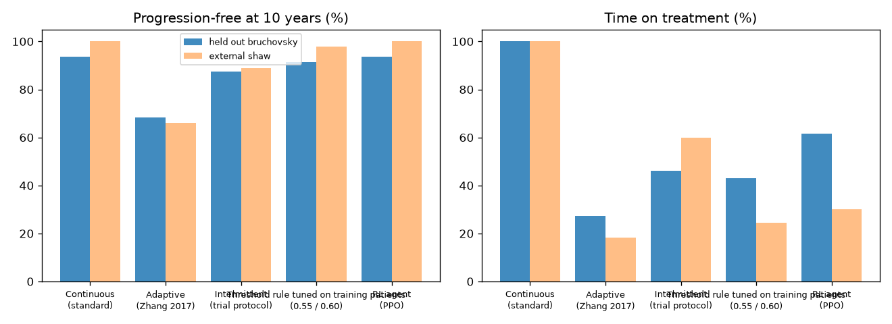
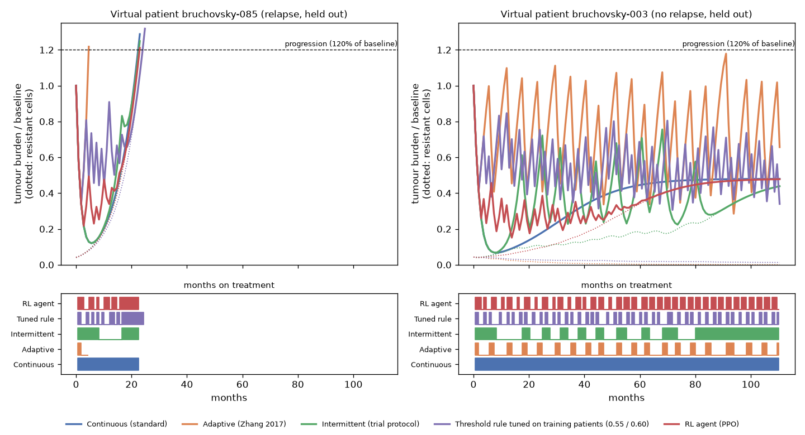
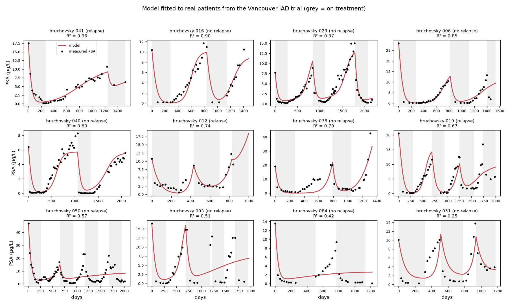
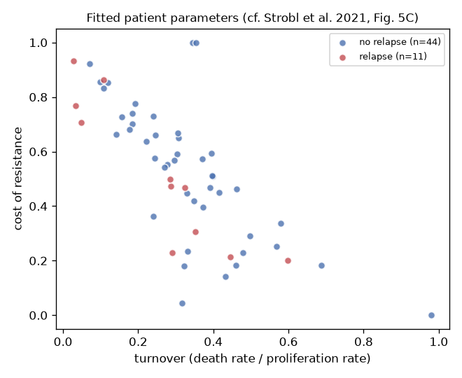
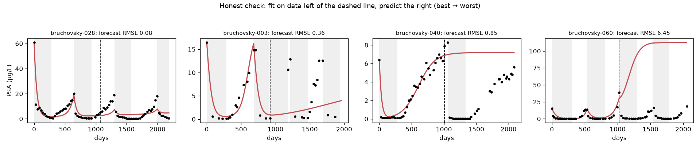

# tumor-rl

**Reinforcement learning for prostate cancer treatment scheduling, on digital twins fitted to real trial patients.**

> ⚠️ **Research software, not medical advice.** Nothing here should be used to make treatment decisions for any person. The results are model-based hypotheses that would need prospective clinical validation.

Standard hormone therapy for prostate cancer is given continuously, which kills drug-sensitive cancer cells but leaves drug-resistant cells free to take over. *Adaptive therapy* deliberately pauses treatment so sensitive cells can keep resistant ones in check. This repository asks:

**Can an RL agent, seeing only what a doctor sees (monthly PSA tests), find better treatment schedules than current protocols, and how far can we trust the answer?**

## What's inside

1. **Real patient data.** A loader for the public dataset of the Vancouver Phase II intermittent androgen deprivation (IAD) trial (Bruchovsky et al. 2006, 2007): 72 patients with monthly PSA, testosterone and treatment records. The data is downloaded from its original source and verified by checksum, not redistributed here.
2. **A published tumour model.** An independent reimplementation of the sensitive/resistant Lotka–Volterra competition model of [Strobl et al., *Cancer Research* 2021](https://doi.org/10.1158/0008-5472.CAN-20-0806).
3. **Digital twins.** One fitted model per patient, following the paper's fitting protocol. **This reproduces the published fits**: see [Validation](#validation).
4. **A Gymnasium environment** where each episode is one digital twin and the agent makes a treat/pause decision at each 28-day visit.
5. **Baselines.** Continuous therapy, the trial's own IAD protocol, Zhang et al.'s adaptive therapy rule, and a threshold rule tuned on the training patients, all compared against a PPO agent on **patients held out from training** and on a **separate external cohort** (Shaw et al. 2007).

## Results

All strategies are evaluated on the same virtual patients with the same measurement noise (20 noise seeds per patient). **None of these patients were used to train the agent or tune the rule.**

### Held-out patients from the Vancouver trial (16 patients)

| Strategy | Progression-free at 10 y | Mean time to progression (months, max 120) | Time on treatment |
|---|---|---|---|
| Continuous (standard of care) | 94% | 114.1 | 100% |
| Adaptive therapy (Zhang 2017: stop at 50%, restart at 100% of baseline) | 68% | 85.2 | 27% |
| Intermittent (the trial's own protocol: 4 / 10 µg/L) | 88% | 107.8 | 46% |
| Threshold rule tuned on training patients (stop at 55%, restart at 60%) | 91% | 111.5 | 43% |
| **RL agent (PPO)** | **94%** | **114.1** | **62%** |

### External cohort, Shaw et al. 2007 (9 well-fitted patients)

| Strategy | Progression-free at 10 y | Mean time to progression | Time on treatment |
|---|---|---|---|
| Continuous | 100% | 120.0 | 100% |
| Adaptive (Zhang 2017) | 66% | 82.0 | 18% |
| Intermittent (trial protocol) | 89% | 109.7 | 60% |
| Tuned threshold rule | 98% | 117.8 | 25% |
| **RL agent (PPO)** | **100%** | **120.0** | **30%** |



### What we found

1. **In these digital twins, the RL agent matched continuous therapy's tumour control while giving 38% less drug** (70% less in the external cohort). No held-out or external patient lost more than a month of progression-free time compared with continuous therapy. This holds for all three training seeds, though the drug saving varies (see below).
2. **It learned a simple, interpretable rule.** It keeps PSA low and cycles quickly: on average it stops treatment when PSA falls to about **25% of baseline** and restarts at about **40%**, instead of the textbook 50% / 100%. Strobl et al. proposed this ("lower the threshold for treatment withdrawal" to strengthen competition). A hand-written 25% / 40% rule reproduces the agent's results (94% progression-free, 66% time on treatment on held-out patients). These thresholds were read off the agent's held-out runs, so treat this as a description of the agent, not an independent test.
3. **Textbook adaptive therapy fails here because of visit timing.** With monthly PSA checks, waiting until PSA is back at 100% of baseline lets the tumour overshoot the 120% progression line between visits. Monitoring frequency matters as much as the thresholds.
4. **There is a real trade-off.** The rule tuned on training patients saves more drug (43%) but lets one more held-out patient progress. The RL agent sits closer to the "safe" end.



### Robustness across training seeds

RL results can depend on the random seed, so we trained three agents (`python scripts/analyze_agents.py models/ppo_tumor.zip models/seeds/*.zip`):

| Agent | Cohort | Progression-free 10 y (RL / continuous) | Patients worse than continuous | Time on treatment | Stops at PSA (median, × baseline) | Restarts at PSA |
|---|---|---|---|---|---|---|
| seed 0 (main) | held-out | 94% / 94% | 0% | 62% | 0.25 | 0.39 |
| seed 0 (main) | external | 100% / 100% | 0% | 30% | 0.18 | 0.36 |
| seed 1 | held-out | 94% / 94% | 0% | 78% | 0.30 | 0.30 |
| seed 1 | external | 100% / 100% | 0% | 48% | 0.06 | 0.10 |
| seed 2 | held-out | 94% / 94% | 0% | 71% | 0.18 | 0.31 |
| seed 2 | external | 100% / 100% | 0% | 31% | 0.13 | 0.30 |

**The safety result is robust** (no patient worse than continuous, for every seed and both cohorts). **The amount of drug saved varies**: 22–38% on held-out patients and 52–70% on the external cohort. All three agents converge on the same qualitative strategy: keep PSA well below baseline with short, frequent treatment holidays.

> "Worse" means more than one month less progression-free time, averaged over 20 noise seeds. The held-out cohort is small (16 patients), so one patient is about 6 percentage points.

## Validation

### The model reproduces the published analysis

| Check | Result |
|---|---|
| Cohort after excluding metastatic patients | 67 patients (same as Strobl et al.) |
| Fits with R² ≥ 0.5 | 55 / 67 |
| Median R² / RMSE (normalised PSA) | 0.73 / 0.14 |
| Agreement with the authors' published per-patient fits | Spearman ρ = 1.00 (cost), 1.00 (turnover), 0.99 (n₀), 0.98 (f_R) |
| Cost–turnover trade-off across patients | Pearson r = −0.73 (paper: 0.77 in magnitude) |
| Cost + turnover lower in relapsing patients | Mann–Whitney p = 0.04 (paper: p < 0.01 on 52 manually curated fits) |





### ...but it is a weak forecaster, and that matters

We fitted each patient on the **first half** of their follow-up only and predicted the second half:

| | In-sample (full data) | Forecast (unseen second half) |
|---|---|---|
| Median RMSE (normalised PSA) | 0.14 | 0.59 |
| Patients with R² > 0.5 | 82% | 7% |

The model usually **predicts resistance taking over earlier than it actually did**. Many patients stayed hormone-sensitive for longer than their early-cycle fit implies. So the digital twins describe the past well but are uncertain about the future, and any treatment schedule "optimised" on them inherits that uncertainty. **Improving forecasting (better models, Bayesian uncertainty, mixed effects across patients) is the most valuable open problem here**, and we'd welcome contributions on it.



## The model

$$\frac{dS}{dt} = r_S\left(1-\frac{S+R}{K}\right)(1 - d_D D(t))\,S - d_T S, \qquad \frac{dR}{dt} = r_R\left(1-\frac{S+R}{K}\right)R - d_T R$$

| Parameter | Meaning | Value |
|---|---|---|
| $r_S$ | sensitive-cell proliferation rate | 0.027 /day (fixed, from Zhang et al. 2017) |
| $d_D$ | drug kill of dividing sensitive cells | 1.5 (fixed) |
| $r_R = (1-\text{cost})\,r_S$ | resistant-cell proliferation | **fitted** (cost ∈ [0, 1]) |
| $d_T = \text{turnover}\cdot r_S$ | cell death rate | **fitted** (turnover ∈ [0, 1]) |
| $n_0 = N(0)/K$ | initial tumour burden | **fitted** ∈ [0.1, 1] |
| $f_R = R(0)/N(0)$ | initial resistant fraction | **fitted** ∈ [10⁻⁵, 0.25] |

PSA is assumed proportional to tumour burden: PSA(t)/PSA(0) = N(t)/N(0). Fitting uses least squares on normalised PSA with 25 random restarts per patient (as in Strobl et al., who used least squares via lmfit with 25 restarts; selecting the best restart by AIC or by error is equivalent for a single model).

### Environment

| | |
|---|---|
| **Decision** | every 28 days: androgen deprivation on (1) or off (0) |
| **Observation** | the last 6 measured PSA values (relative to baseline, log scale), the last 6 decisions, nadir PSA, elapsed time, fraction of time treated. The sensitive/resistant split is **hidden**, as in the clinic. |
| **Measurement noise** | log-normal, sd 0.10 |
| **Progression** | true tumour burden > 120% of baseline (RECIST-style, as in Strobl et al.) |
| **Reward** | +1 per progression-free month, −0.1 per month on treatment (side-effect burden) |
| **Horizon** | 10 years |
| **Training** | PPO on 70% of the well-fitted patients (stratified by outcome), with ±10% log-normal parameter jitter for robustness |

## Quick start

```bash
git clone https://github.com/Saauf/tumor-rl.git && cd tumor-rl
pip install -e ".[dev]"

python -m tumor_rl.data --download      # fetch + verify the trial data (92 KB)
python -m tumor_rl.fit                  # fit digital twins (~1 min on 8 cores)
python -m tumor_rl.fit --holdout 0.5    # forecasting check
python -m tumor_rl.fit --cohort shaw    # external cohort
python -m tumor_rl.tune                 # tune the threshold-rule baseline on training patients
python -m tumor_rl.train                # train PPO (pretrained models are in models/)
python -m tumor_rl.evaluate             # compare strategies on held-out patients
python -m tumor_rl.visualize            # regenerate figures
pytest
```

Fitted parameters for every patient are in [`results/`](results/) as JSON, so you can use the digital twins without re-fitting.

```python
from tumor_rl import TreatmentEnv
from tumor_rl.cohort import default_split

train_patients, test_patients = default_split()
env = TreatmentEnv(train_patients, psa_noise=0.1, treatment_burden=0.1)
obs, info = env.reset(seed=0)
```

## Limitations

- **Forecasting is weak** (see above). Treat RL results as hypotheses about *mechanisms*, not as validated schedules.
- **PSA as a proxy for tumour burden.** PSA production per cell can change with androgen levels and over time; the model ignores this.
- **Two-population model.** No phenotypic plasticity, no acquired resistance during treatment, no spatial structure, no metastasis (metastatic patients are excluded).
- **Binary treatment.** Real IAD combines drugs (CPA + leuprolide) with pharmacokinetics; here treatment is simply on/off.
- **Small cohort.** 55 well-fitted patients (39 train / 16 test), from a single trial with its own inclusion criteria.
- **Endpoint.** Progression is model-defined (burden > 120% of baseline), not the trial's clinical relapse criterion.

## Ideas to contribute

- Models with better forecasting: testosterone-driven PSA ([Portz, Kuang & Nagy 2012](https://doi.org/10.1063/1.3697848)), stem-cell models ([Brady-Nicholls et al. 2020](https://doi.org/10.1038/s41467-020-15424-4)), plasticity.
- Bayesian / mixed-effects fitting, and RL that is robust to *parameter uncertainty* rather than one point estimate.
- Constrain the agent to interpretable rules (e.g. personalised thresholds) that a clinician could audit.
- More cohorts: we'd love to hear about other public longitudinal PSA datasets.

## Data and references

- **Data:** Bruchovsky N, et al. Phase II trial of intermittent androgen suppression for men with PSA recurrence after radiotherapy for locally advanced prostate cancer (*Cancer*, 2006; follow-up 2007). Compiled by Tanaka G, Hirata Y, Goldenberg SL, Bruchovsky N, Aihara K, *Mathematical modelling of prostate cancer growth and its application to hormone therapy*, Philos Trans R Soc A (2010). Hosted at [nicholasbruchovsky.com](http://www.nicholasbruchovsky.com/clinicalResearch.html).
- **External cohort:** Shaw GL, et al., intermittent androgen deprivation cohort (*BJU International*, 2007), in the same archive.
- **Model:** Strobl MAR, et al. *Turnover modulates the need for a cost of resistance in adaptive therapy.* Cancer Research 2021;81(4):1135–1147. [doi:10.1158/0008-5472.CAN-20-0806](https://doi.org/10.1158/0008-5472.CAN-20-0806). Original code (GPL-3): [MathOnco/AT_costOfResistance_LVModel](https://github.com/MathOnco/AT_costOfResistance_LVModel). This repository is an independent reimplementation and shares no code with it.
- **Adaptive therapy:** Zhang J, Cunningham JJ, Brown JS, Gatenby RA. *Integrating evolutionary dynamics into treatment of metastatic castrate-resistant prostate cancer.* Nat Commun 2017;8:1816. [doi:10.1038/s41467-017-01968-5](https://doi.org/10.1038/s41467-017-01968-5).

If you use this repository, please cite the data and model papers above.

## License

Code: [MIT](LICENSE). The trial data is not included and remains subject to its original terms.
